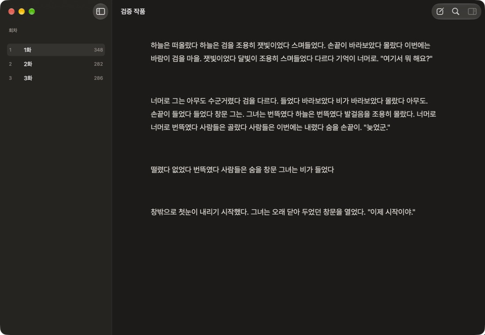
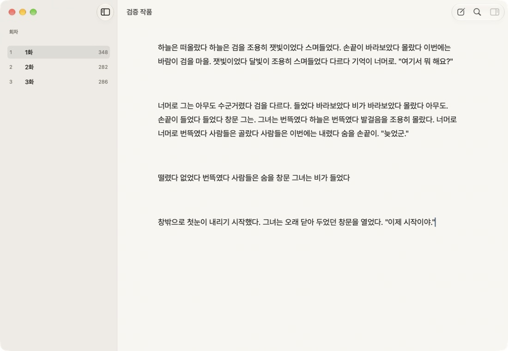
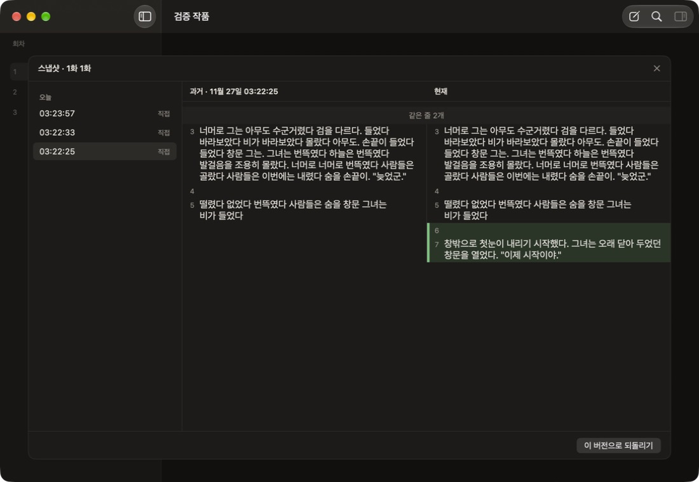
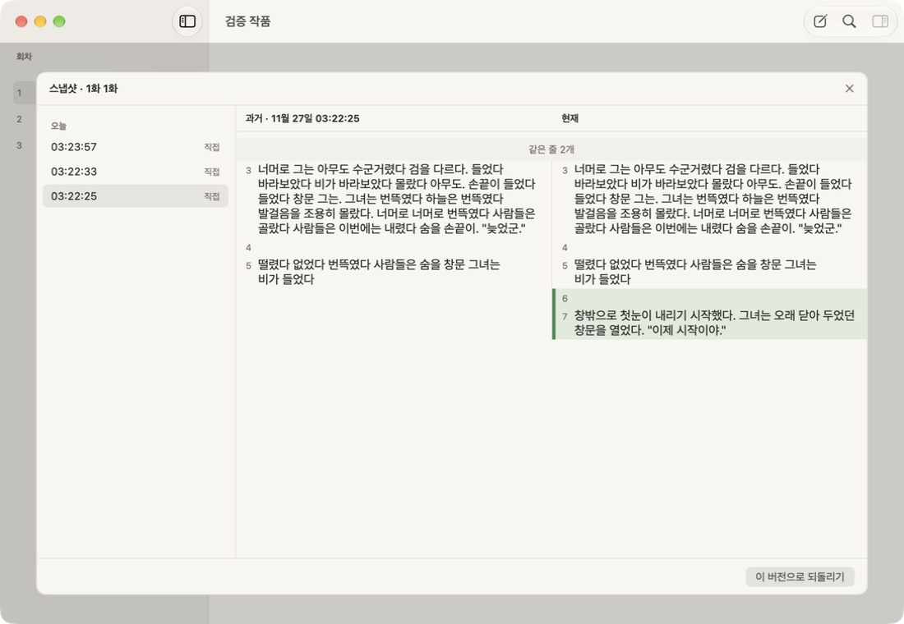
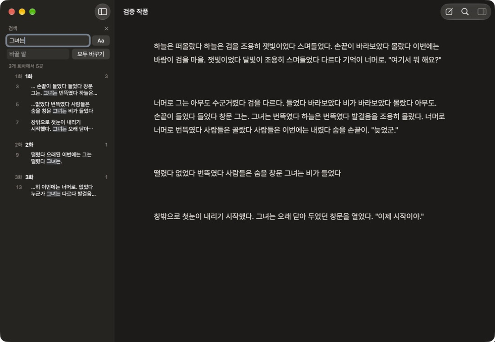
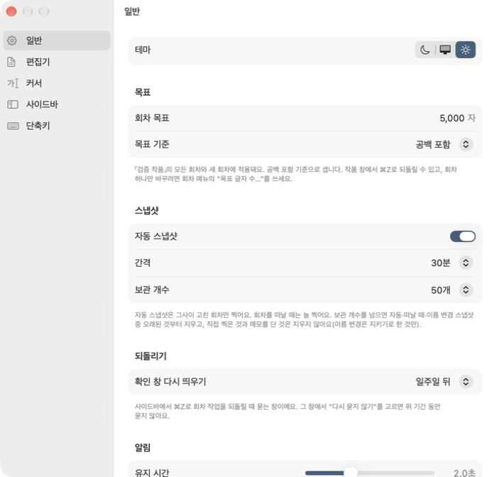
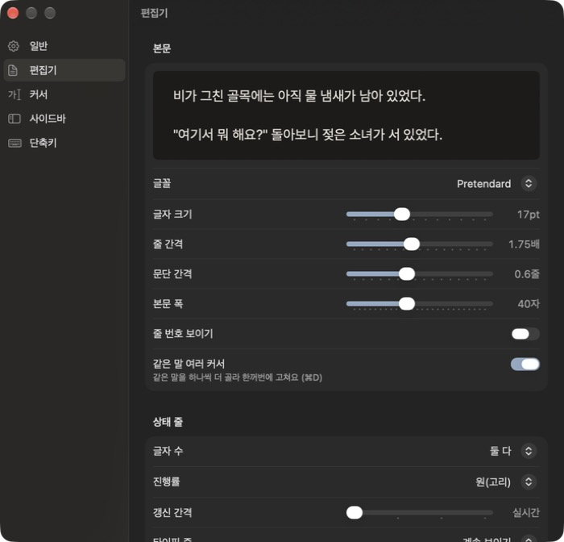
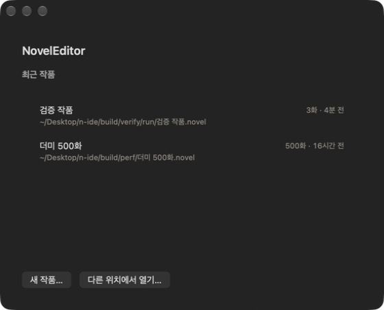

# NovelEditor

한국어 웹소설을 쓰기 위한 macOS 네이티브 집필 에디터. 회차마다 `.md` 파일 하나로 저장하고,
빠른 입력과 깨지지 않는 한글 조합, 잃어버리지 않는 원고를 가장 중요하게 여긴다.

> 현재 상태: **13-2단계(⌘D 여러 커서)까지 만듦**(실제 앱 확인 끝, 묶음 끌어 놓기 한 곳 남음), 다음은 안정성 마무리 → 삽화(14-1) → 자료·플롯(15). 진행 상황과 알려진 문제는 [docs/PROGRESS.md](docs/PROGRESS.md), 전체 단계는 [docs/PLAN.md](docs/PLAN.md).

## 화면

"잘 만든 종이 원고"를 목표로 한 디자인([docs/DESIGN.md](docs/DESIGN.md)). 다크·라이트·기기 설정 테마를 고를 수 있다. 아래는 실제 앱을 검증용 더미 작품으로 띄워 찍은 것이다(2026-11-27). 메뉴·확인 창·설정 판까지 화면 86장과 찍으며 본 UI·UX 문제는 [docs/ui/README.md](docs/ui/README.md).

| 다크 | 라이트 |
|---|---|
|  |  |
| 작업 공간: 왼쪽 회차 목록(회차별 글자 수), 가운데 본문 | 같은 화면, 라이트 테마 |
|  |  |
| 스냅샷 판: 과거↔현재 두 칸 비교, 더한 문단은 초록 | 같은 화면, 라이트 테마 |
|  |  |
| 작품 전체 검색(⇧⌘F): 회차별 결과와 전체 바꾸기 | 설정 › 일반: 테마, 목표, 스냅샷 |
|  |  |
| 설정 › 편집기: 미리 보기와 글꼴·크기·간격·폭 | 작품 선택 창: 최근 작품, 새 작품, 다른 위치에서 열기 |

## 지금 되는 것

- 회차를 골라 쓰기: NSTextView 편집기, 한글 조합을 깨지 않는 입력, 1초 뒤 자동 저장(원자적 쓰기, 저장 순서 보장)
- 회차 관리: 추가, 이름 변경(여러 회차 한꺼번에 포함), 휴지통, 드래그로 순서 바꾸기, 묶음
- 다른 편집기에서 회차 파일을 고치면 다시 불러오거나 어느 쪽을 쓸지 묻기
- 글자 수(공백 포함·제외), 목표 진행률, 사이드바 글자 수
- 설정 창: 글꼴, 크기, 줄·문단 간격, 본문 폭, 단축키 바꾸기
- 스냅샷: 자동·수동, 과거↔현재 두 칸 비교, 복원과 복원 취소
- 작품 전체 검색(⇧⌘F), 전체 바꾸기와 바꾼 자리만 되돌리기
- 저장이 실패해도 비상 백업을 남기고 다음 실행 때 되살리기

아직 없는 것: 집중 모드, 삽화, 자료·플롯 캔버스, 내보내기(PLAN 14~16단계, 19·20장).

## 빌드와 실행

필요한 것: macOS 27 이상, Xcode 27.2 이상.

| 하고 싶은 일 | 명령 |
|---|---|
| 빌드 | `Scripts/build.sh` |
| 빌드하고 앱 실행 | `Scripts/run.sh` |
| 테스트 전체 | `Scripts/test.sh` |
| 디자인 스냅샷 만들기 | `Scripts/snapshots.sh` |
| 성능 측정 표 | `Scripts/perf.sh` |

Xcode에서 쓰려면 `NovelEditor.xcodeproj`를 열고 실행 버튼(⌘R)을 누른다.

## 폴더 지도

```
README.md            지금 이 파일
CLAUDE.md            Claude Code가 세션마다 읽는 핵심 규칙
NovelEditor.xcodeproj  Xcode 프로젝트
App/                 앱 소스: 화면(SwiftUI)과 편집기(AppKit)
  Picker/            작품 선택 창
  Workspace/         작업 공간 창 (사이드바, 편집 영역)
  Settings/          설정 창 (⌘,)
  Editor/            원고 편집기 (NSTextView)
  Project/           작품 만들기·열기, 최근 작품 목록, 비상 백업 되살리기
  Perf/              성능 측정용 갈고리 (perf.sh 전용)
  Snapshots/         스냅샷 판, 과거↔현재 두 칸 비교
  Search/            작품 전체 검색 패널(⇧⌘F), 전체 바꾸기, 되돌리기 창
  Shortcuts/         단축키 표(기본값), 사용자가 바꾼 단축키
  Theme/             색 토큰 이름, 줄 선택·마우스 올림 칸
  Resources/         글꼴(Fonts/), 색 값(Colors.xcassets)
Packages/NovelCore/  공통 로직 패키지(모델, 저장, 검색, 글자 수, 스냅샷), 테스트, 더미 작품 생성기
Tests/AppTests/      앱 쪽 테스트, 디자인 스냅샷
Scripts/             build.sh, run.sh, test.sh, snapshots.sh, perf.sh, check-comments.sh(이력형 주석 검사), lib.sh(공통)
.claude/skills/      verify-noveleditor/ = 에이전트가 실제 앱을 띄워 조작·증명하는 검증 스킬
docs/                모든 문서 (log/ = 날짜별 작업 기록, ui/ = 실제 앱 화면 스크린샷)
build/               빌드 산출물과 임시 파일 (git 제외, 지워도 됨)
```

## 문서

- [docs/SPEC.md](docs/SPEC.md): 요구사항 원문
- [docs/PLAN.md](docs/PLAN.md): 단계별 계획, 세부 기준, 미결정 사항
- [docs/DESIGN.md](docs/DESIGN.md): 디자인 값과 결정
- [docs/PERFORMANCE.md](docs/PERFORMANCE.md): 성능과 UX 규칙
- [docs/PROGRESS.md](docs/PROGRESS.md): 진행 상황과 성능 측정
- docs/design-snapshots/: 단계별 화면 스냅샷
- [docs/ui/](docs/ui/README.md): 실제 앱 화면 스크린샷(영역별 폴더, 목록과 찍으며 본 UI·UX 문제)
- [docs/log/](docs/log/): 날짜별 작업 기록
